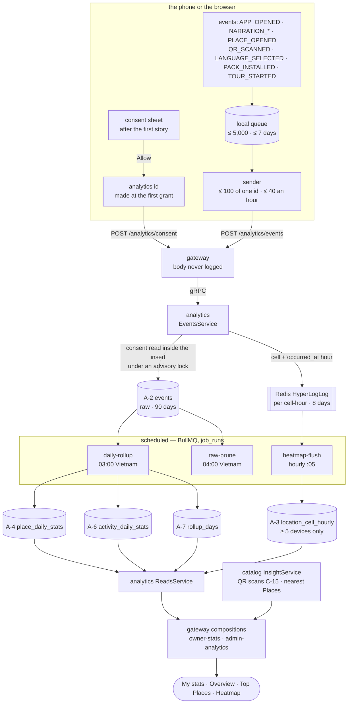

# Flow — a story heard becomes a number on a dashboard

**From a tourist's tap on *Allow* to the owner's *My stats* and the admin's heatmap.** What the phone records and when, how the server refuses what it must, which jobs turn raw events into the rollups every dashboard reads, and why the freshness lines say what they say. The consent-free runtime lane runs beside it and never meets it.

**Triggers:** a tourist allowing counting (Android, or a browser); every event the apps record afterwards; four scheduled jobs in `analytics`; a dashboard read in the console.

---

## 1. The path

**One owner for every number.** Only `analytics` runs analytics jobs; the only figure from elsewhere is QR scans, which catalog counts without consent (C-15) and the gateway joins at read time.

---

## 2. Consent, and the server's gate

The phone asks once, after the first story that played sound ends, then once more after the next story if the question was closed, then only in Settings. **The gate is the server's, not the app's goodwill:**

- `EventsService.ingest` reads the id's newest A-1 row **inside its own insert transaction**, after taking `pg_advisory_xact_lock` on the id's hash; `recordConsent` takes the same lock. A batch racing a withdrawal either commits first (and the withdrawal deletes it) or reads `WITHDRAWN` and stores nothing. There is **no consent cache** to go stale.
- A grant must name the current privacy policy (`LEGAL_DOCUMENT_VERSIONS`), else `409 LEGAL_VERSION_OUTDATED`; a withdrawal never checks the version.
- An events batch without a current grant answers `403 CONSENT_REQUIRED`, and the app stops counting until the tourist chooses again (a new policy re-asks those who had allowed).

**Withdrawing deletes the id's raw events in the same transaction.** The app withdraws **every id it used in the last 90 days** — the id rotates every 30 days (`ANALYTICS_ID_ROTATION_DAYS`), and older ids' raw events may still be held. The next `daily-rollup` then removes the id from every day it still rebuilds. The heatmap's counters hold no id, so nothing there needs removing.

---

## 3. Ingest — what is refused, what is kept

| What arrives | What happens |
| :---- | :---- |
| a coordinate field anywhere, more than `ANALYTICS_BATCH_MAX` events, a malformed envelope | **the whole batch** `400` — a client bug, loudly (`hasCoordinateField`) |
| one event failing its type's `props` (`ANALYTICS_EVENT_PROPS`), or a `VOUCHER_VIEWED` while vouchers aren't available | that event dropped and counted in one log line; the rest stored |
| an event id already stored | dropped — a retried batch is safe |
| `occurredAt` a week old or in the future | clamped to `[received − 7 d, received + 5 min]` (`clampOccurredAt`) |
| a `cell` (geohash-7, snapped on the device) | the id added to the HyperLogLog of that cell and the event's **`occurred_at` hour** (`heatmapKey`); no row stores the cell |

**Location never arrives as a coordinate.** The device snaps its last fix (under 5 minutes old) to a ~150 m square before the event is queued; the web only uses a position the tourist already shared.

---

## 4. The jobs, and why their windows are what they are

| Job | When (Vietnam time) | Does | Why that window |
| :---- | :---- | :---- | :---- |
| `heatmap-flush` | hourly at :05 | re-counts **every cell-hour counter still held** (8 days) and upserts A-3 where the estimate is ≥ `HEATMAP_MIN_DEVICES` | a phone uploads up to a week late; re-counting means a late phone lands in its own hour and a flush never overwrites an hour with only its late arrivals. An estimate never falls, so a written square never needs removing |
| `runtime-flush` | hourly at :05 | each finished hour's Area counters → A-5 | the runtime lane, below |
| `daily-rollup` | 03:00 | rebuilds **yesterday and the 7 days before** from A-2 into A-4 and A-6, each day replaced in one transaction; records the day in A-7 | the 7-day clamp; a rebuild replaces, so re-running changes nothing |
| `raw-prune` | 04:00 | A-2 after `RAW_EVENT_RETENTION_DAYS`; A-1 400 days after an id's newest row | everything durable is a rollup |

The crons run in the business time zone (`BUSINESS_TIME_ZONE` in the shared jobs module). **A day more than 90 days back can't be rebuilt** (`rebuildable` in `rollup-window.ts`): its raw events are gone. `pnpm --filter @wayfare/analytics job <name> [--day D]` runs one job by hand (`scripts/run-job.ts`) — never a route.

**A-6 is never summed over languages.** Per day and platform, the totals (sessions, active devices, pack installs, searches) are on the `lang = '*'` row; the per-language rows carry narrations only. Active devices are an exact distinct count of the day's ids — an upper bound, since rotation counts an install twice — and **a range shows the daily mean**, because distinct ids can't be added across days.

---

## 5. The reads and their freshness

| Read | Composed by the gateway from | Freshness it shows |
| :---- | :---- | :---- |
| *My stats* (owner) | the owner's Venues (catalog `ListMyPlaces`), A-4, QR scans (`GetQrScans`) | `dataThrough` — the newest A-7 day |
| Overview, Top Places (admin) | A-4, A-6, QR scans; Top Places' names and categories from `BatchGetPlaceSummaries` (deleted Places dropped) | `dataThrough` |
| Heatmap | A-3 over the range and an hour band in Vietnam time (converted to UTC); the ten busiest squares labelled by `NearestLivePlaces` | `computedThrough` — when the squares were last re-counted |
| Activity | A-5, and **this hour so far** from the live counters | none — it is the current hour |

**Fields follow the owner's plan:** `BASIC` has narrations, finished, average listening and QR scans; `FULL` adds stopped early, page opens, how stories started and the CSV export; `NONE` is `403 ANALYTICS_LEVEL_INSUFFICIENT`. **A field beyond the plan is absent, not zero.** Ranges are business days, at most `ANALYTICS_RANGE_MAX_DAYS`.

---

## 6. The runtime lane — consent-free, and kept apart

The Android app reports `POST /telemetry/activity { areaId }` at most every 15 minutes while in front or walking, and only within 1 km of a synced Place (the area is that Place's, so no position leaves the phone). **The gateway** adds the device to that Area's hour counter (`runtimeKey`) and stores nothing else; an Area it doesn't serve isn't counted. `runtime-flush` writes finished hours to A-5. It needs no consent because it knows only that *some* install was active in a 1.5 km² area — and it lives in its own table so that merging it with the 150 m consented squares would be a schema change someone has to propose, not a query someone can write.

---

## 7. Edge cases

| Situation | What happens | Why that, and not an error |
| :---- | :---- | :---- |
| A phone offline for a month | it sends its last week; older events were dropped on the phone | the server would clamp them anyway, and a clamped event lands on the wrong day |
| A batch arrives while its id is withdrawn | nothing stored | the advisory lock orders the two (§2) |
| A cell reaches 5 phones only after late uploads | the square appears then | the hourly re-count over 8 days |
| A Venue moved to another owner | its earlier days go with it | A-4 is per Place, not per owner |
| A Place deleted | dropped from Top Places, the list still filled | catalog no longer returns it |
| The owner's plan drops below Pro mid-session | the export answers `403`; the page refreshes to the new depth | the level is read per request |
| An Area with no squares | an empty heatmap, never `500` | `computedThrough` arrives as `null` over gRPC |
| A rollup day older than 90 days requested by hand | refused, saying so | its raw events are pruned |

---

## 8. When it misbehaves — where to look first

| Symptom | Look at |
| :---- | :---- |
| Dashboards stopped moving | `/admin/jobs` for `daily-rollup`, then `rollup_days` — `dataThrough` is its newest day |
| No events arrive from a test phone | Diagnostics' *Analytics* block (consent, queue, last send); a `403` means the consent is missing or on an old policy |
| A Venue's numbers look low | consent: only tourists who agreed are counted; QR scans are the one exact figure |
| The heatmap is empty for a busy area | squares under 5 phones are never written; then `heatmap-flush` in `/admin/jobs` |
| A withdrawn tourist still appears | days older than the rebuild window keep their totals by design (§2) |
| *Last 7 days* on Activity shows fewer hours | `RUNTIME_HOURS_MAX` — one constant in contracts for the gateway and the service |

---

## 9. Related

- [`../sys-flows.md`](../sys-flows.md) — where analytics sits among the services
- [api-endpoints-plan](../../api-endpoints-plan.md) §7; [rdm-spec](../../rdm-spec.md) §3.5 (A-1–A-7, the jobs), C-15
- ADR [0042](../../decisions/0042-the-analytics-device-is-not-the-identity-device.md) — the analytics id is not the device
