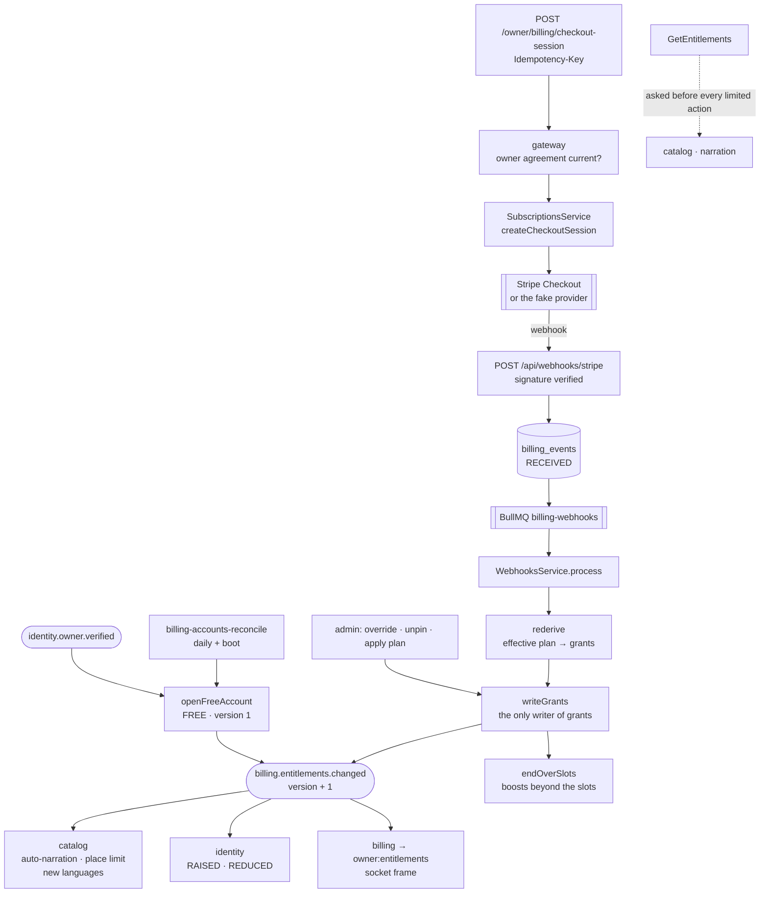
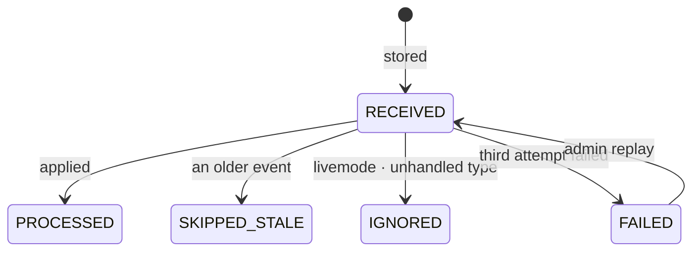

# Flow — an owner pays, and what their plan allows changes everywhere

**From a verified owner's free account, through a Stripe subscription, to the grants every other service obeys.** Billing never decides what a Venue may do in the moment; it keeps **one effective grant set per owner**, versioned, and announces each change. Catalog, identity and the console act on the announcement; catalog and narration also ask, synchronously, before any limited action — and are refused if billing can't answer.

**Triggers:** `identity.owner.verified`; an owner's checkout; Stripe's webhooks; an admin's pin, unpin or plan change; a boost set by the owner.

---

## 1. The path

**Checkout never writes a grant.** Only a processed webhook does, so an abandoned checkout, a declined card or a closed tab changes nothing.

---

## 2. The account and the subscription

- **Every verified owner has an account on FREE**, opened by `OwnerVerifiedConsumer` (idempotent on the owner) and, as a safety net, by `billing-accounts-reconcile`, which pages identity's `ListVerifiedOwnerIds` at boot and daily — a missed event can't leave an owner without an account.
- **Checkout** (`createCheckoutSession`): the price must be live; a status already `ACTIVE`, `TRIALING` or `PAST_DUE` is `409 SUBSCRIPTION_EXISTS` (changes go through the Customer Portal); the Stripe customer is created once (`customer:<accountId>` as Stripe's idempotency key); the session expires 31–36 minutes ahead on a 5-minute step, so a retried request with the same key gets the same session. **Prices are USD only** (a database check).
- **The fake provider** (`PAYMENTS_PROVIDER=fake`, refused in production) serves a checkout page in the console whose *Pay* inserts the same three webhook rows Stripe would send — `checkout.session.completed`, `customer.subscription.created`, `invoice.paid` — through the same queue. The webhook signature is never faked.

| Status (`SubscriptionStatus`) | Grants |
| :---- | :---- |
| `ACTIVE`, `TRIALING`, `PAST_DUE` | the subscribed plan's (`subscribedPlanApplies`); `PAST_DUE` also shows the dunning banner |
| `NONE`, `INCOMPLETE`, `INCOMPLETE_EXPIRED`, `UNPAID`, `CANCELED`, `PAUSED` | FREE's |

Billing keeps no transition table of its own: **the status is whatever Stripe's newest event says.** A cancellation is `cancel_at_period_end` (grants unchanged) and, at the period's end, `customer.subscription.deleted` → FREE.

---

## 3. Webhooks — stored first, processed in order

1. **Intake** (`receiveStripeEvent`): the signature is verified (`StripeWebhookVerifier`, 300 s tolerance) — a bad one is `400` and nothing is stored; the account is resolved by `client_reference_id`, subscription or customer; the row is inserted `RECEIVED` — **a repeated Stripe event id is acknowledged and changes nothing**; the row is queued.
2. **Processing** (`process`): only a row still `RECEIVED`. A `livemode` that doesn't match `STRIPE_MODE` → `IGNORED`. Subscription events pass a **monotonic guard** on `last_stripe_event_at`: older → `SKIPPED_STALE`; the same second → re-read the subscription from Stripe and apply what it says now; newer → apply. Invoice events have their own guard (`last_invoice_event_at`). Anything unhandled → `IGNORED`.
3. **Failure:** retried after 10 s and 60 s; after the third attempt `FAILED`, audited — an admin can **replay** it (`FAILED` → `RECEIVED` only).
4. **A crash between insert and queue** is caught by `billing-webhooks-recover` (every 5 minutes and at boot), which re-queues rows `RECEIVED` for over a minute with no queue item.

---

## 4. Entitlements — derived, pinned, versioned, announced

- **`derive`**: the effective plan (the subscribed plan when its status applies, else FREE), its grants through `grantsFor`, each numeric grant clamped to `PLATFORM_CEILINGS`. It writes nothing.
- **`rederive`** sets the account's effective plan and, **unless the account is pinned**, writes the grants. A pinned account still tracks its subscription; only its grants stay as the admin set them.
- **`writeGrants` is the only writer of grant columns.** If nothing changed, nothing is written. On a change: the columns, **`entitlements_version + 1`**, boosts beyond the new slots ended (newest first), and `billing.entitlements.changed { entitlements, previous, entitlementsVersion, cause }` — `cause` one of `SUBSCRIPTION`, `PLAN`, `OVERRIDE`, `UNPIN`.
- **Every write locks the account first** (`lockAccount`, `FOR NO KEY UPDATE`), and no gRPC or Stripe call happens while it is held.

| Consumer | Does |
| :---- | :---- |
| catalog | ignores a version not newer than the one it recorded (`owner_entitlements`); sets each Venue's auto-narration; **unpublishes the newest published Venues beyond the place limit** to `INACTIVE` (`ENTITLEMENT_LIMIT`) or reactivates the oldest such when there is room again (drafts count, never unpublished); asks narration for newly covered languages |
| identity | a narrowing (`narrowedDimensions`), whatever the cause → `ENTITLEMENTS_REDUCED` in the bell and by email; a widening only from `OVERRIDE` or `UNPIN` → `ENTITLEMENTS_RAISED` in the bell — a purchase announces itself with `SUBSCRIPTION_ACTIVATED` instead |
| billing | the `owner:entitlements` socket frame, so an open console updates its limits |

**Asked, not only told:** catalog (a submission, an approval, the limits page, a reactivation) and narration (a Venue's language) call `GetEntitlements` before acting, and **any failure denies** — `503 ENTITLEMENTS_UNAVAILABLE`, never an assumed grant.

**Vouchers wait** ([ADR 0066](../../decisions/0066-the-voucher-chain-waits-for-a-way-to-pay-vietnamese-venues.md)): while `VOUCHERS_AVAILABLE` is false, a change to the voucher grant is neither a raise nor a reduction, so it notifies no one — the version still moves.

---

## 5. Discovery boosts — visual surfaces only

- **The owner sets the whole set** (`PUT /owner/boosts`): each Place checked with catalog first (outside the lock; a failure is `503` and nothing written), then, under the lock, ownership, the slot count (`409 BOOST_SLOTS_EXCEEDED`) and the change — ended boosts first, then started ones.
- **`BoostsLedgerService` is the only writer of boost rows.** Each start or end publishes `billing.boosts.changed`; an end for a system reason (`ENTITLEMENT_LIMIT`, `PLACE_UNAVAILABLE` from catalog's `place.status_changed`) also publishes `billing.boost.ended`, which identity turns into `BOOST_ENDED` for `PLACE_UNAVAILABLE` only.
- **Catalog writes `places.discovery_boost`** only when `changedAt` is newer than the last change, and **without bumping `sync_version`** — so a boost never reaches a device's synced records, the walk or narration. It weighs the nearby ranking (`rankNearby`, after the radius filter, marked *sponsored*) and nothing else ([ADR 0007](../../decisions/0007-paid-placement-never-reaches-the-audio-channel.md)).

---

## 6. Plans, from the admin's side

- **A plan's grants change only for subscribers when the admin applies it** (`applyPlan`, with a dry run): accounts whose effective plan it is, pinned ones skipped and counted, each rederived in its own transaction — one failure fails that account only. The dry run reports how many Venues would be unpublished (catalog's `CountOwnerPlaces`; omitted if catalog didn't answer) and boosts that would end.
- **A price is registered from Stripe's** after checks — interval, currency (USD), amount, product — replacing the interval's previous active price. FREE is assigned, never sold. A plan with subscribers can't be retired.

---

## 7. Edge cases

| Situation | What happens | Why |
| :---- | :---- | :---- |
| Stripe redelivers an event | acknowledged, no new row | the unique Stripe event id |
| An older subscription event arrives late | `SKIPPED_STALE` | the monotonic guard |
| Two subscription events in one second | Stripe re-read, its current state applied | ordering by second is a tie |
| `payment_failed` again and again | dunning dates from the first; the owner told each time | one streak, many attempts |
| A test-mode event on a live deployment | `IGNORED` | `livemode` must match `STRIPE_MODE` |
| A price not registered | retried, then `FAILED`; replay after registering | an admin fixes the catalogue, then the event |
| A pinned account renews | status and plan update; grants don't | the pin is the admin's |
| Grants fall below live boosts | the newest boosts end in the same transaction | slots are a grant |
| An old entitlements event replayed | catalog ignores it by version; identity by event id | idempotent consumers |
| Billing down during a limit check | `503 ENTITLEMENTS_UNAVAILABLE` | deny, never assume |
| A missed `owner.verified` | the reconcile opens the account | the event stream's retention isn't forever |

---

## 8. When it misbehaves — where to look first

| Symptom | Look at |
| :---- | :---- |
| Paid, still on FREE | `billing_events` for the account: `FAILED` with "no plan price" → register the Stripe price, then replay; `entitlements_pinned` |
| Events stuck `RECEIVED` | the `billing-webhooks` queue and its worker; `billing-webhooks-recover` in `/admin/jobs` |
| Every event `IGNORED` | `error_log`: `LIVEMODE_MISMATCH` (`STRIPE_MODE`) or `UNHANDLED_TYPE` |
| A webhook answers `400` | `STRIPE_WEBHOOK_SECRET`; the gateway's raw body |
| Grants changed, Venues didn't | billing's `outbox_events` for `billing.entitlements.changed`; catalog's `owner_entitlements` version; the consumer's dead letters |
| No "reduced" email | `narrowedDimensions` found nothing (a raise, or a voucher-only change) |
| A boost not in nearby | `places.discovery_boost` and its `changed_at`; is the Venue `ACTIVE`? |
| A boost vanished | `discovery_boosts.ended_reason`: `ENTITLEMENT_LIMIT` (a grant change) or `PLACE_UNAVAILABLE` |
| Checkout or portal `503` | the Stripe key, or Stripe down |

---

## 9. Related

- [`../sys-flows.md`](../sys-flows.md) — billing among the services
- [api-endpoints-plan](../../api-endpoints-plan.md) §5, §6, §10; [rdm-spec](../../rdm-spec.md) B-1–B-5; [product-overview](../../product-overview.md) §8
- ADRs [0007](../../decisions/0007-paid-placement-never-reaches-the-audio-channel.md), [0066](../../decisions/0066-the-voucher-chain-waits-for-a-way-to-pay-vietnamese-venues.md)
