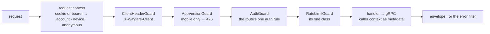
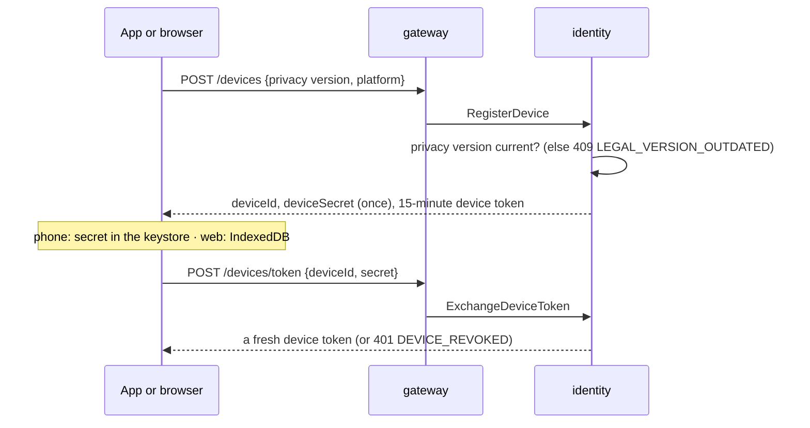
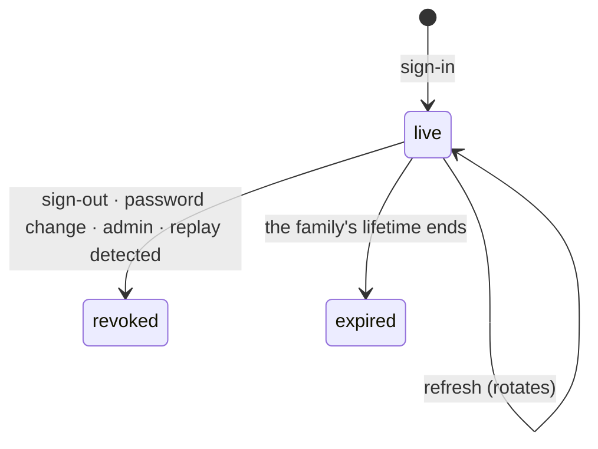
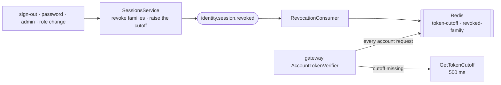

# Flow — an install, an account, and every request in between

**How an anonymous phone or browser gets an identity, how an account signs in and stays signed in, how a token is taken back, and what the gateway checks on every request.** The tourist never has to sign in ([product-overview](../../product-overview.md) §3.1): the **device** is the primary identity, and an account *claims* it. Identity is the only service that signs tokens; the gateway holds only the public keys and checks every request against a revocation cutoff it caches in Redis.

**Triggers:** a first launch; a sign-up, sign-in or Google sign-in; a refresh; a sign-out, a password change, an admin action; every request through the gateway.

---

## 1. Every request — the gateway's path

- **The caller is resolved once** (`createRequestContextMiddleware`), and never throws: a bad token becomes an `authError` (`invalid`, `revoked`, `unverifiable`) that the route's rule then judges. The console and the web send cookies; the web and the phone send a bearer; a console bearer is ignored.
- **Every route has exactly one auth rule** — `PUBLIC`, `DEVICE`, `USER`, `USER_EMAIL`, `OWNER`, a permission, or `SIGNATURE` for provider webhooks — or the gateway refuses to boot (`RouteContractCheck`). Every route has one rate-limit class.
- **Services never read who the caller is from a body**: the gateway packs the verified context into gRPC metadata (`packCallerContext`).
- **Errors** are one envelope (`{ error: { code, message, details?, requestId } }`); `429` and `503` carry `Retry-After`; a peer's coded error keeps its status, an uncoded `UNAVAILABLE` is `503`, a deadline `504`.

---

## 2. An anonymous install

- **The secret is returned exactly once** and stored hashed; a token is exchanged for it every 15 minutes. A revoked device sends the phone back to its first run, and the web silently registers a new install.
- **A new privacy policy** answers `409 LEGAL_VERSION_OUTDATED` with the current version, and the app shows its notice again.
- **Forgetting a device** (`DELETE /devices/me`) revokes it and every account session on it, and announces `identity.device.forgotten` (catalog drops its favourites). **Device tokens aren't revocation-checked**: a forgotten device's token works on `DEVICE` routes until it expires, at most 15 minutes.

---

## 3. Accounts and sessions

| Way in | What identity does |
| :---- | :---- |
| **Register** (email, password, the terms) | a user with the `USER` role, a verification email, then sign-in |
| **Sign in** (password) | an unknown email, a wrong password and a deactivated account all answer the same `401 INVALID_CREDENTIALS`, with a dummy hash check so timing reveals nothing; a lock is revealed only after a correct password |
| **Continue with Google** ([ADRs 0062–0064](../../decisions/0062-tourists-may-continue-with-google.md)) | a nonce bound to the device (or, in the console, to a short cookie), spent once; the ID token checked; then: a known link signs in, a new email creates the account, an address Google owns links by itself, and any other address needs the password first (a 5-minute link ticket); staff never sign in with Google |

**Every sign-in ends the same way** (`signIn`): the device is claimed by the account (taken from another account if it had it, that account's sessions on it revoked; `identity.device.claimed` moves favourites), and a **session family** opens — a refresh token and a 30-minute account token carrying the permissions, the device, and whether the owner and the email are verified.

- **A refresh rotates the token and never extends the family** (7 days for the console and the web, 30 for the phone). **A rotated token presented again is a replay**: the whole family is revoked — except within 10 seconds on the console or the web, where two tabs racing get `409` and nothing is revoked.
- **Cookies** (console `wf_at`/`wf_rt`, web `wf_wat`/`wf_wrt`) are `httpOnly`, `Secure`, `SameSite=Lax`, host-only; the phone keeps its tokens in the keystore and receives them in the body.
- **Proving it's you again** — for an email change, erasure or unlinking Google — takes the current password, or a fresh Google confirmation (`/auth/google/confirm`).

---

## 4. Taking a token back

- **A cutoff per user** (`users.tokens_valid_after`, mirrored in Redis by a raise-only script) rejects every token issued before it; **a family marker** rejects one session's tokens. A role or permission change raises the cutoff without ending sessions, so the next refresh carries the new permissions.
- **If Redis or identity can't answer, an account route answers `503`** — never an unchecked pass ([sys-flows](../sys-flows.md) §3). Public routes are unaffected.
- **An erased or unknown user's cutoff** is "reject everything".

---

## 5. Owners, notifications and email

- **Becoming an owner**: an application (`USER_EMAIL` — a verified email), with the national id encrypted (`v1:` AES-256-GCM), reviewed by staff (never one's own). Approval stamps `owner_verified_at`, adds the `VENUE_OWNER` role, raises the cutoff (so the next token says *owner*), and announces **`identity.owner.verified`** — billing opens the free account ([billing-and-entitlements](./billing-and-entitlements.md)).
- **Deactivating or erasing an owner** first asks billing whether anything is still live (`GetLiveObligations`, `GetErasureBlockers`); if billing can't answer, nothing is written (`503`). Erasure replaces the email, deletes links, identities and notifications, redacts the application's personal data, and announces **`identity.user.erased`**.
- **Notifications** are written only by identity (`NotificationsService.deliver`), from its own work or any service's `notification.create` and the events it consumes — one row per recipient and event, then a socket frame to the console. Expired after 90 days.
- **Email** is prepared inside the transaction that causes it (an `email_deliveries` row) and sent after commit with the row id as the provider's idempotency key; after a hard bounce only security emails go out; Resend's webhooks move a delivery's status forward only.

---

## 6. Edge cases

| Situation | What happens | Why |
| :---- | :---- | :---- |
| Two console tabs refresh at once | the second gets `409`; nothing revoked | a race isn't a theft |
| The phone presents a rotated token | the family is revoked; the app says *signed in elsewhere* | a replay is a theft until proven otherwise |
| A refresh for a locked or erased account | the family revoked, a plain `401` | a stolen token learns nothing |
| Signing in on a device another account had | the device moves; the other account's sessions on it end | one person per phone |
| A Google token replayed, or used on another device | refused (`NONCE`) | the nonce is spent once, by its owner |
| An address held by an email-change revert | reserved for everyone for 7 days | the revert must be able to hand it back |
| Billing down during an erasure | `503`, nothing written | fail closed on obligations |
| A notification event redelivered | no second row, no second frame | unique per recipient and event |

---

## 7. When it misbehaves — where to look first

| Symptom | Look at |
| :---- | :---- |
| `400 CLIENT_HEADER_REQUIRED` | the client's `configureApiClient({ client })`; CORS's allowed headers |
| The phone stuck on *Update required* | `MIN_SUPPORTED_APP_VERSION`; the version header the app sends |
| The privacy notice keeps coming back | `LEGAL_DOCUMENT_VERSIONS` against the app's version |
| Back to first run unexpectedly | `DEVICE_REVOKED` from `/devices/token` |
| Account routes `503`, public fine | the gateway's Redis; identity's reachability; `GetTokenCutoff`'s 500 ms |
| Signed out right after an admin action | expected — a cutoff raise; the client refreshes on `401` |
| A revocation slow to take effect | identity's outbox; `RevocationConsumer`; the Redis keys |
| *Signed in elsewhere* with no other device | the audit's `REFRESH_TOKEN_REPLAY_DETECTED`; the app's single-flight refresh |
| Approved owner without owner features | the token still says not-owner — the client must refresh |
| An email never arrived | the `email_deliveries` row: none (suppressed after a bounce, or erased), `QUEUED`, `FAILED`; Mailpit locally |

---

## 8. Related

- [`../sys-flows.md`](../sys-flows.md) — identity as the sink for audit and notifications
- [api-endpoints-plan](../../api-endpoints-plan.md) §0.1–§0.3, §1, §9; [rdm-spec](../../rdm-spec.md) I-1–I-14; architecture §10
- ADRs [0042](../../decisions/0042-the-analytics-device-is-not-the-identity-device.md), [0062](../../decisions/0062-tourists-may-continue-with-google.md)–[0064](../../decisions/0064-google-links-by-itself-only-where-google-owns-the-mailbox.md)
