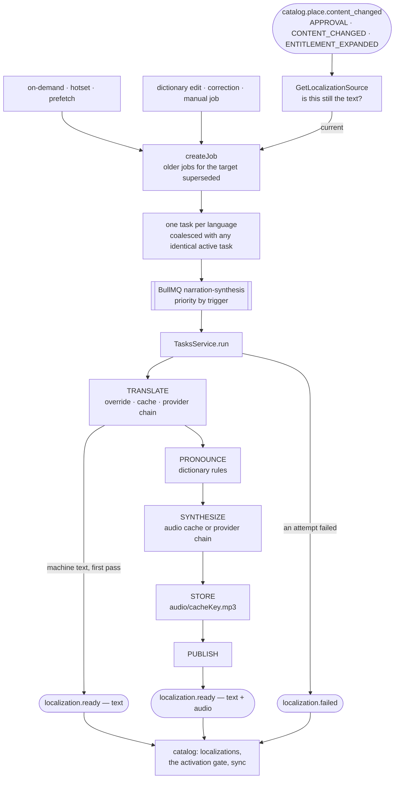
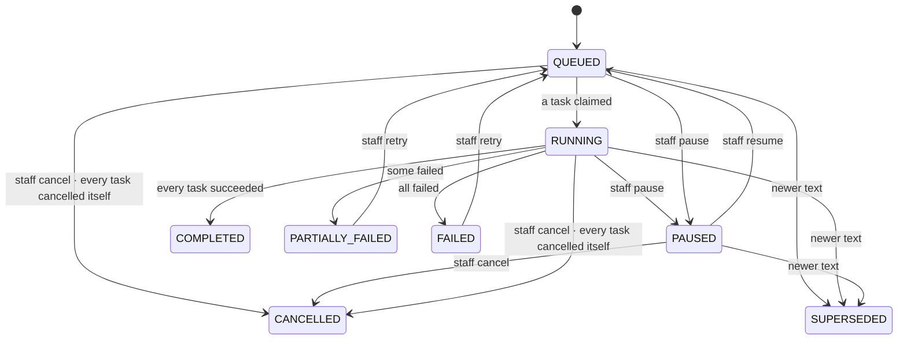

# Flow — a Place's Vietnamese text becomes a story in five languages

**How narration turns a Place's source text into translated text and spoken audio, how a tourist's phone gets audio it doesn't have yet, and what happens when a provider is down.** Narration never writes a Place: it announces each language as it becomes ready, and catalog decides what that means ([place-lifecycle](./place-lifecycle.md)). Everything expensive — translation, speech — is cached by what it was made from, so the same text never costs twice.

**Triggers:** `catalog.place.content_changed` (and its menu and tour siblings); a tourist's on-demand request, hotset, prefetch or live stream; staff editing the pronunciation dictionary or correcting a translation; staff pausing, resuming, cancelling or retrying a job.

---

## 1. The path

**A job** is one request for one target (a Place, a menu item, a tour) in several languages; **a task** is one language of it, moving through the stages. A job made from `catalog.place.content_changed` always includes Vietnamese — the source, voiced without translation; on-demand, hotset, prefetch, correction, manual and dictionary jobs carry only the languages asked.

---

## 2. Jobs and tasks

| Rule | How |
| :---- | :---- |
| **Newer text wins** | a new job supersedes every live job of the same target made from a **different** source hash; their tasks are cancelled |
| **The same work runs once** | an advisory lock on `target:lang:hash` (`lockKey`) and a check for an active task with that key in `activate`: a second identical request becomes a **follower** of the active task and ends with its result — twenty phones asking at once cost one synthesis |
| **…unless it carries a change the leader predates** | a `HUMAN_EDIT`, `HUMAN_REVERT` or `DICTIONARY_CHANGED` task meeting a leader that has already **started** doesn't follow it — its correction or pronunciation would be lost in the leader's result; it waits (`rerun_after_leader`) and runs on its own once the leader finishes |
| **The tourist waiting goes first** | BullMQ priority by trigger (`SYNTHESIS_PRIORITY`): on-demand 1, hotset 2, staff edits 4, approval and content changes 5, prefetch 7, dictionary and entitlement fan-outs 9 |
| **Three at a time** | `SYNTHESIS_CONCURRENCY` (1–3) per process |
| **Text that changed under a task** | each task re-reads its source (`GetLocalizationSource`) before working and cancels itself if the Place was edited or deleted — never counted as a failure, never published |

A job's status is **recomputed from its tasks** in the same transaction as any task change (`settle`), its row locked `FOR NO KEY UPDATE` in a fixed order — two tasks finishing together can't leave a job running forever or deadlock (conventions §8.8). A transaction that hits a deadlock or serialization failure is retried whole — three tries in all (`TRANSACTION_TRIES`) — and never counted as an attempt.

---

## 3. The stages

1. **Translate** (`SynthesisService.localizedText`): Vietnamese is the source; otherwise **a staff correction for this exact text** (`localization_overrides`, `HUMAN`) wins; otherwise the translation cache; otherwise the translation provider chain (`MACHINE`), cached. A correction made for older text is retired on the spot.
2. **Publish the text early**: for a machine-translated Place, a text-only `narration.localization.ready` goes out now, so the text is served while the audio is made. A human correction waits and publishes text and audio together.
3. **Pronounce**: the dictionary's rules for the language (and the language-free ones), longest term first, whole words, into SSML.
4. **Synthesize**: **the audio cache key is the SSML, language, voice and format** — an unchanged text is a cache hit; a dictionary change that touches nothing costs nothing. On a miss, the speech chain, sentence-split to each provider's input limit; the parts joined.
5. **Store**: `audio/<cacheKey>.mp3`, immutable, and an `audio_assets` row (the first writer wins).
6. **Publish**: `narration.localization.ready` with text and audio.

**A language with no voice under any configured provider** (`speakersFor` empty — the long-tail languages) publishes its text and then `localization.failed` with `NO_VOICE`, final — every such text marked `noVoice: true`, a staff correction's included (the event's schema requires the mark only of a human Place correction, which otherwise must carry its audio); the task counts as succeeded, and catalog tells no owner — it isn't a fault.

---

## 4. When a provider fails

| Failure | What happens |
| :---- | :---- |
| The input is refused (an unsupported language; a sentence too long for the **first** provider tried — the chain rethrows without trying the others) | final at once |
| **The speech providers are all unreachable** (timeouts, network) | **not counted**: the task waits 1, 5, then every 15 minutes, for up to 24 hours (`PROVIDER_OUTAGE_*`) before it is final |
| Anything else — a provider that answered with an error, translation down, catalog's gRPC down, storage | counted: retried after 5 s and 30 s; final at the third |

Every failed attempt publishes `localization.failed` (`final` on the last). **The provider chain fails over** on a timeout, a network error, a `5xx`, a `429` or an empty answer, and a provider that failed three times in a row rests for 60 s (per process; `GET /admin/narration/providers` shows it). **A failure about the text itself** (`TextFailedError`) fails over **without counting toward the breaker**, so one text a provider refuses can't switch it off for every other — the task's attempt still counts as usual. Only the fake speech provider throws it today; Google's and Edge's report no such failure.

**A crashed worker** loses nothing: a running job's heartbeat (every 5 s) goes stale after `JOB_STALE_AFTER_MS` (5 minutes) — so recovery can take about ten — and `synthesis-recover` (every 5 minutes and at boot) re-queues its tasks uncounted, re-adds tasks whose queue item was lost, and rehomes orphaned followers. Postgres, not Redis, is the record.

---

## 5. A tourist who needs audio now

| Route | Does | Answers |
| :---- | :---- | :---- |
| `POST /narration/on-demand` | served audio for the current text → `READY` with its URL; a language with no voice whose text is current → `UNAVAILABLE` (no job — the phone uses its own voice); else joins or creates an `ON_DEMAND` job (priority 1); a Venue's language must be in its owner's plan (`LANGUAGE_NOT_ENTITLED`; billing unreachable → `503`) | `200 READY`, `202 PENDING` with `retryAfterMs` (`ON_DEMAND_RETRY_AFTER_MS`, 1 s), `200 UNAVAILABLE` |
| `GET /narration/places/:id/status` | what is ready for a language, and whether it is stale | the app polls it every `retryAfterMs` while it waits — at most 5 s, then it falls to the stream |
| `GET /narration/tts/stream` (and its single-use, 60-second ticket for the web's `<audio>`) | the same text and SSML as a task would make; the cached file if there is one, else one synthesis per cache key (a Redis lock), the others waiting up to 25 s; past a 23 s budget the winner answers `503` while its synthesis **finishes in the background, the lock kept**, so the file is still stored and published and the next tourist gets it | the MP3, or `503` if the synthesis failed or ran past its budget; `409` for no voice or a language outside the plan |
| `POST /narration/hotset` | the 10 nearest live Places within 1.5 km (no boost); a `HOTSET` job for each without ready audio — **a Venue whose owner's plan doesn't cover the language is skipped, and so is any Venue when billing can't answer** (a grant is never assumed); if catalog can't list the candidates, an empty answer and no job | `ready`, `pending`, `requiredReadyCount` — a language switch waits for 3 ready |
| `POST /narration/prefetch` | up to 3 named Places; a `PREFETCH` job for each without ready audio, Venues checked against their owner's plan as for the hotset | `queued`, `skipped` |

On-demand, hotset, prefetch, the stream and its ticket's `POST` share the `NARRATION_ON_DEMAND` rate limit (30 per 10 minutes per device); the status poll is `LINK_READ`, and the ticket's `GET` is `PUBLIC_READ`, by IP (known-gaps row 14). The phone's side of this — its ladder from file to on-demand to stream to its own voice — is in [the-walk](./the-walk.md).

---

## 6. Staff changing how things sound

- **The pronunciation dictionary**: saving, editing or deleting an entry queues a **fan-out** (`narration-dictionary-fanout`) that pages catalog's `SearchLocalizedText` for every live localization **made from the Place's current text** containing the term as a whole word (a stale one is left to the content job already in flight — matching it once superseded that job and lost the audio), and creates a `DICTIONARY_CHANGED` job per target — stopping at 2,000 targets with a metric and a log ("re-save the entry to continue"). Only texts whose SSML actually changed are re-synthesized. A failed page resumes from its cursor, four tries.
- **Translation corrections**: a correction is checked against the current source hash (`LOCALIZATION_SOURCE_CHANGED` otherwise), replaces the active one, and creates a `HUMAN_EDIT` job; a revert creates `HUMAN_REVERT`.
- **Job controls** (`/admin/narration/jobs`): pause, resume, cancel, retry the failed tasks (from the stage they reached; caches make earlier stages free), and a manual job — each audited, each refused from the wrong status (`SYNTHESIS_JOB_NOT_ACTIVE`).

---

## 7. Edge cases

| Situation | What happens | Why |
| :---- | :---- | :---- |
| A catalog event redelivered | a no-op (`processed_events`) | idempotent consumers |
| An event for text catalog no longer holds | recorded, no job | the source is re-read first |
| The Place edited while a task runs | the old job superseded; the running task cancels at its next check, publishing nothing | never a story about old text |
| A paused job's task is claimed, or a running one meets the pause | it waits as `QUEUED` with **no queue item**; only *Resume* enqueues it again | pause holds work, not workers |
| The leader of followers is cancelled | the oldest live follower is promoted | other requests still get their audio |
| A cached audio row whose file is gone | treated as a miss and made again | the cache is a hint; storage is the truth |
| Machine text and audio | text served first, audio after | a tourist reads while the voice is made |
| A failure event before its text row | catalog redelivers it — up to ten times (`MAX_DELIVER`), then it is dead-lettered | the row must exist to be marked |
| Two streams of the same text at once | one synthesis | a lock per cache key |

---

## 8. When it misbehaves — where to look first

| Symptom | Look at |
| :---- | :---- |
| A Place stuck in `PROCESSING` | the stuck list (`/admin/places/stuck`), its last job's status and `error_summary`; whether `content_changed` left catalog's outbox and reached narration's `processed_events`; the two consumers' dead letters |
| A job `RUNNING` forever | `heartbeat_at` (stale after 5 minutes, swept every 5); `synthesis-recover`'s row in narration's `job_runs`; the tasks' stage and `next_attempt_at` |
| A task waiting for hours | `failure_reason = PROVIDER_UNAVAILABLE`, `provider_down_since`; `/admin/narration/providers` |
| Text shown, no audio | a machine-translated Place between its two `ready` events: the task's stage |
| Audio `FAILED` for one language | the task's `last_error` and the job's `error_summary` (`"<lang>: <reason>"`), or narration's `outbox_events` — catalog keeps no failure events; `NO_VOICE` means no voice under any configured provider (`speakersFor`) |
| Every task of a language fails at once | `UNSUPPORTED_LANGUAGE` from the translation chain (`translateField`) |
| On-demand stays `PENDING` | the task's leader (`coalesced_into_task_id`) and that job — paused? waiting out a speech outage (`failure_reason`, `next_attempt_at`)? in its retry back-off? the queue full at `SYNTHESIS_CONCURRENCY` |
| Stream `503` | `narration_tts_stream_total{outcome}`; the Redis lock `narration:tts:<cacheKey>`; the speech chain — and, uncounted by that metric, `ENTITLEMENTS_UNAVAILABLE` (billing down, a Venue) or catalog failing to read the Place |
| A dictionary edit changed nothing | the fan-out's logs (gave up, or stopped at the cap); an entry never changes Vietnamese audio (`rulesFor('vi')` is empty); only `ACTIVE`, non-deleted targets are searched; a term matches its diacritics exactly |
| Cached audio made again | `narration_audio_cache_missing_total` and "a cached audio object is gone; synthesizing again" — the row outlived its file |
| `/admin/narration/providers` differs between two reads | the breaker's state is per process; each replica answers its own |

---

## 9. Related

- [`place-lifecycle.md`](./place-lifecycle.md) — what catalog does with each `ready` and `failed`
- [`the-walk.md`](./the-walk.md) — the phone's audio ladder
- [rdm-spec](../../rdm-spec.md) N-1–N-7; [api-endpoints-plan](../../api-endpoints-plan.md) §4, §10; [product-overview](../../product-overview.md) §F3; [development-conventions](../../development-conventions.md) §8.8
