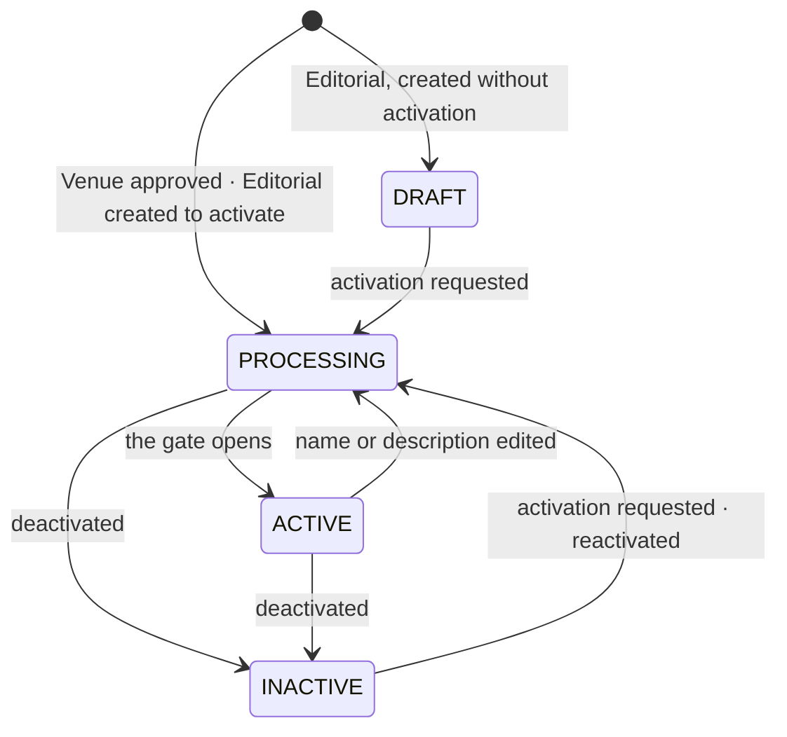
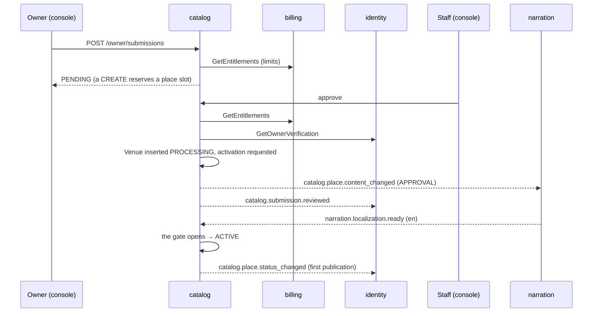

# Flow — a Place goes from a submission to a tourist's phone

**How a Place is born, reviewed, narrated, made public, changed, paused and deleted.** Catalog owns every status; narration only announces that a language is ready, and billing only announces what an owner may have. The one rule everything else serves: **a Place is public only when its English text and audio match its current content** — so a tourist never hears a story about a Place that no longer reads that way.

**Triggers:** an owner's submission; a staff member's edit, activation or deletion; narration's results; billing's entitlement changes; an owner's erasure.

---

## 1. The statuses

`PLACE_TRANSITIONS` in `places/domain/place-lifecycle.ts` is the whole table; anything else is refused (`INVALID_STATE`). **`INACTIVE` always carries its reason** (a database check), and the reason decides who may lift it:

| `inactive_reason` | Set by | Lifted by |
| :---- | :---- | :---- |
| `ADMIN` | staff's *Deactivate* | staff's *Activate* |
| `OWNER` | the owner's *Pause*; an owner's erasure | the owner's *Reactivate* (a limit check first) |
| `ENTITLEMENT_LIMIT` | a plan that allows fewer Places | a wider plan (oldest first), or the owner's *Reactivate* if there is room |

**Deletion is a flag, not a status** (`deleted_at`): the row stays as a tombstone for sync, its localizations are kept, and *Restore* brings it back with its status. A Place on a live tour can't be deleted (`PLACE_IN_ACTIVE_TOUR`), nor a Venue with live vouchers — and if billing can't say, the delete is refused (`UPSTREAM_UNAVAILABLE`).

---

## 2. From a submission to a Place

- **A submission is born `PENDING`** — there is no server-side draft. It ends `APPROVED`, `REJECTED` (always with a note), `WITHDRAWN` (by the owner, or by erasure) or `SUPERSEDED` (a newer update for the same Venue).
- **Limits are checked twice**, at submit and at approve, against billing's live answer (`ENTITLEMENTS_UNAVAILABLE` if it can't say). A pending CREATE reserves a slot, and the owner's advisory lock (`lockOwner`) serialises two approvals racing for the last one.
- **An update is checked for conflicts:** if the live Venue changed since the owner started (`editableHash`), submit answers `SUBMISSION_CONFLICT`; at review, the reviewer sees the changed fields and must acknowledge them.
- **Two reviewers at once:** one decision wins, the other gets `INVALID_STATE`.
- **An unverified or departed owner** can't have a submission approved (`OWNER_NOT_VERIFIED`).

---

## 3. The activation gate

`ActivationGate.evaluate` (`places/domain/activation-gate.ts`) opens when **all** hold, and reports what's missing in this order:

| Missing | Means |
| :---- | :---- |
| `en.text` | no English localization whose source hash equals the Place's `content_hash` |
| `en.audio` | its audio isn't `READY`, or was made from older text |
| `activation` | nobody asked for it to go public (`activation_requested_at`) |

It is evaluated when activation is requested, on reactivation, after a wider plan, and **whenever narration delivers English** (`LocalizationsService.applyPlace`). Opening stamps `published_at` the first time — that is the owner's *first publication* notification.

**Editing a name or description re-closes it by hash, not by clearing anything:** the new `content_hash` makes the English row stale, the Place returns to `PROCESSING` and **disappears from tourists** until narration catches up; non-text edits (photos, menu, hours, category, location, radius) change nothing. A stale localization is still served in the meantime to anyone with the Place open, marked `stale`, and audio is served only when it matches the text it reads (`servedAudio`).

**When narration gives up** (`narration.localization.failed`, final): the audio is marked `FAILED`, the owner is told (unless the language simply has no voice), and the Place stays `PROCESSING` — listed after an hour with no job as **stuck** on the console's Home and the Places list, with *Make narration again*.

---

## 4. What a plan change does to Places

`billing.entitlements.changed` → `applyEntitlements`, **ignored if its version isn't newer** than the one recorded in `owner_entitlements` (written last, so a crash and redelivery finish the work):

1. **Auto-narration** set on each Venue whose flag differs.
2. **The place limit:** Venues counted are `DRAFT`, `PROCESSING` and `ACTIVE`, oldest first. Over the limit, **the newest published ones** become `INACTIVE` (`ENTITLEMENT_LIMIT`) — drafts count but are never unpublished. With room, **the oldest** `ENTITLEMENT_LIMIT` Venues return to `PROCESSING` and through the gate.
3. **A wider language scope** asks narration for the new languages on every live Venue (`ENTITLEMENT_EXPANDED`).

---

## 5. Who hears about a status change

**Every write that changes what a tourist could see is one transaction**: the change, at most one `catalog.place.status_changed` (the net change, with `firstPublication` and `deleted`), and the sync bump as its last statement (`withSyncWrite`). Then:

| Listener | Does |
| :---- | :---- |
| a tourist's phone | sees the change on its next sync — a live Place as a record, anything else as a removed id ([sync-and-offline](./sync-and-offline.md)) |
| identity | tells a Venue's owner about changes they didn't make |
| billing | ends the Place's boost when it stops being live |
| the owner's open console | a socket frame (`ownerPlaceStatus`), after commit, best effort |

**Tours** follow the same statuses with a text-only gate (no audio), and are **available only with two live stops** — decided when read, so a stop's Place going inactive hides the tour without touching it (`TOUR_UNAVAILABLE`).

---

## 6. Edge cases

| Situation | What happens | Why |
| :---- | :---- | :---- |
| Text edited while `PROCESSING` | stays `PROCESSING`; narration asked again | the gate waits for the newest text |
| Text edited on a `DRAFT` | nothing is narrated until activation | no cost for a Place nobody asked to publish |
| Narration's answer for older text | a stale row beats none; a current one beats stale | `localizationWrites`' currency rule |
| A failure event arriving before its text | thrown, redelivered | the row it marks must exist |
| Staff *Activate* on an owner's pause | refused | only the owner, or a wider plan, lifts their reasons |
| Deleted while `PROCESSING`, then restored | narration asked again | narration drops work for deleted Places |
| An owner erased | Venues paused as `OWNER` (drafts deleted); pending submissions withdrawn | nothing of theirs stays public |
| An old entitlements event redelivered | ignored by version | the projection is written last |
| An area deactivated | activation, reactivation and restore refused (`AREA_INACTIVE`) | nothing goes live where no tourist can go |

---

## 7. When it misbehaves — where to look first

| Symptom | Look at |
| :---- | :---- |
| A Place stuck in `PROCESSING` | *Activate*'s `missing[]`; the English row's hashes against `content_hash`; `audio_status = FAILED`; the stuck list and narration's jobs; the consumer `catalog-narration-localization-ready` and its dead letters |
| A Place vanished after an edit | by design until English text and audio return (§3) |
| A Venue went `INACTIVE` by itself | `inactive_reason`: `ENTITLEMENT_LIMIT` (`owner_entitlements`' version, the plan) or `OWNER` after an erasure |
| A Venue didn't come back after an upgrade | it is `PROCESSING` with stale audio; the consumer's dead letters |
| An owner wasn't told | `outbox_events` for `catalog.place.status_changed`; identity's consumer |
| Delete refused | `PLACE_IN_ACTIVE_TOUR` (a live tour lists it), `PLACE_HAS_LIVE_VOUCHERS`, or billing unreachable |

---

## 8. Related

- [`narration.md`](./narration.md) — what happens between `content_changed` and `localization.ready`
- [`billing-and-entitlements.md`](./billing-and-entitlements.md) — where the limits come from
- [`sync-and-offline.md`](./sync-and-offline.md) — how a change reaches a phone
- [rdm-spec](../../rdm-spec.md) §1.6, C-1–C-8; [api-endpoints-plan](../../api-endpoints-plan.md) §3, §10; [product-overview](../../product-overview.md) §F5–§F7
