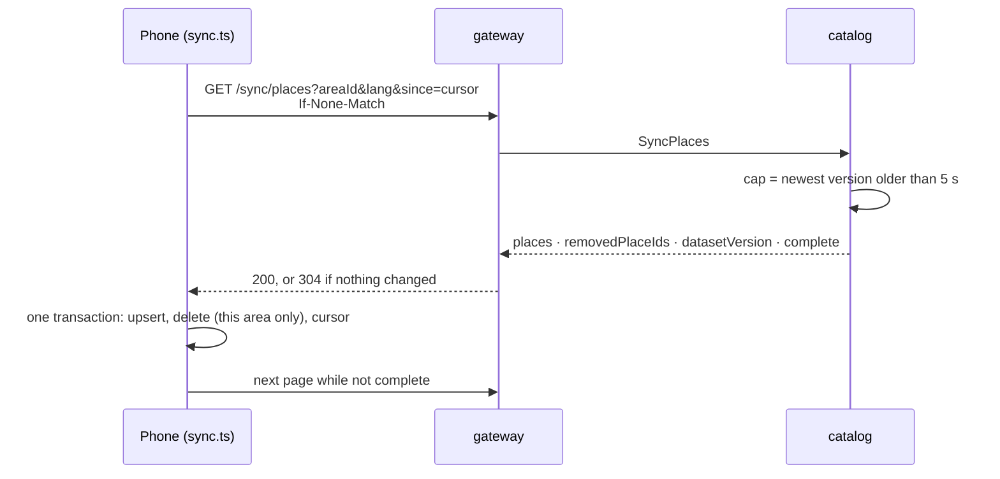
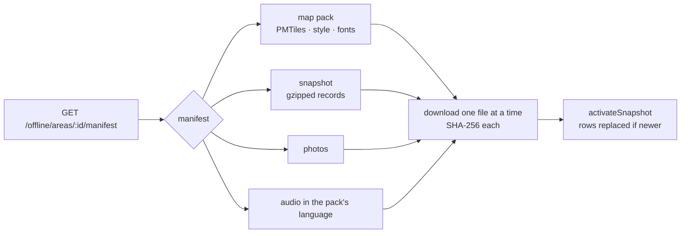
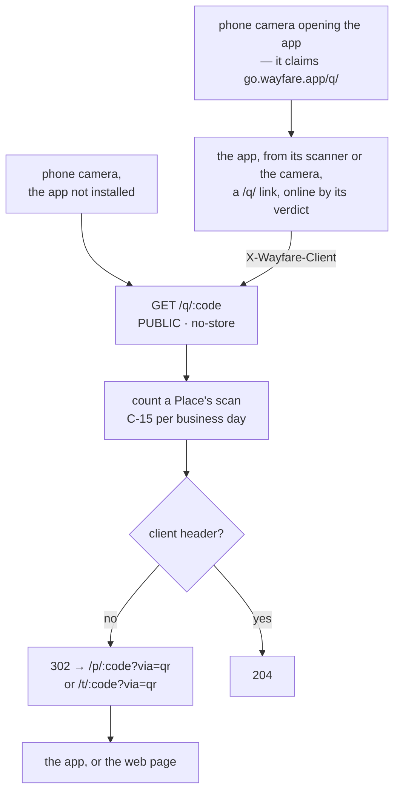

# Flow — Places reach a phone, and stay there offline

**How the server's catalog becomes rows in a phone's SQLite, how a whole area goes into airplane mode, and how a sticker on a wall opens the right Place.** Three mechanisms, one idea: **a single, monotonically rising version number** that every observable change bumps, so a phone only ever asks *"what changed since N?"*.

**Triggers:** the app's launch, its return to the front and the network coming back (sync); the tourist downloading an area (packs); a camera, the in-app scanner or a typed code (codes).

---

## 1. Delta sync — `GET /sync/places`

- **One sequence for everything** (`catalog_sync_version_seq`, shared by Places and tours). **Every write a tourist could observe** — the Place, its photos, menu, hours, the auto-narration flag — ends with the Place's bump, in the same transaction (`withSyncWrite`). **A localization stamps its own version instead** (`stampLocalizationVersion`), and **a Place's version for a language** is the greater of its own and that of the row its records are served from — the language's own row, or English's when it has none (rdm-spec §1.7) — so a translation reaches only the phones that show it. A discovery boost moves nothing: paid ranking never reaches a phone's records.
- **The cap** is the newest version whose row is more than 5 s old (`SYNC_SAFETY_LAG_MS`), never below `since`. A slow transaction that commits a lower number late is therefore never skipped: the lag plus the transaction's own 4 s limit cover it.
- **A page** is up to 500 changes across all areas: live Places of the asked area come back as full records; **every other changed id comes back as removed** — deleted, paused, or moved to another area (a first sync, from `since=0`, has no removed ids). The phone deletes only within the area it asked about, so a Place that moved isn't lost from the area it moved to.
- **Each record carries one language**, resolved down the content chain — the asked language, else English, else the Vietnamese source — with `contentTier` and `stale` saying which ([conventions](../../development-conventions.md) §11.2), and audio only when it matches its text.
- **`304`**: the ETag is `"<areaId>:<lang>:<datasetVersion>"`; it matches only when nothing changed anywhere since the cursor; a cursor past changes only other languages saw gets a complete, empty page.
- **On the phone**, `place_records` (one row per Place and language) and `sync_state` (the cursor per area and language). An **incomplete** page that doesn't move the cursor forward throws — the guard against looping on the same page; a complete page at the same version is normal. Tours sync the same way (`/sync/tours`), and the phone decides which stops are live.

---

## 2. Offline packs — an area in airplane mode

- **The manifest** lists every file with its size and SHA-256: the area's published map pack, a **snapshot** of its live Places in one language (generated once per version, under a lock, and reused), each card photo, and each story's audio. It is cached by the area, language, cap and map pack version.
- **The phone downloads in order** — map, places, photos, audio — one file at a time, each into a `.part` file, hashed, and kept only on a match (a mismatch is fetched once more, then the pack fails *check*). It waits for a connection or Wi-Fi as the tourist chose, and checks for 1.1× the space it needs once before the run (after clearing caches), then 1.0× before each file.
- **Activating** replaces the area's rows for that language — **only if the snapshot is newer than the phone's cursor**; an older snapshot leaves the synced rows alone.
- **Updates** take the manifest's diff (what changed since the phone's version); an old map pack already pruned answers `DIFF_UNAVAILABLE`, and the phone falls back to the full manifest.
- **Map packs** are registered by staff from a build in the bucket (every file re-hashed, at most 60 MB), then published — one published pack per area; the previous one retires and is pruned after 30 days.

---

## 3. Codes and QR stickers

One code space for Places and tours (C-19 `public_codes`, written only by triggers): 8 Crockford characters, never reused — a new Place's or tour's random code is inserted only if no code of either kind holds it, else another is drawn — forgiving to type (`canonicalPublicCode`: case, spaces, dashes, O→0, I/L→1).

- **Every Place scan is counted** — live or not — and no one's details are kept; a tour's isn't (C-15 is per Place). If catalog doesn't answer, the redirect still goes to `/p/` uncounted, and the web forwards a tour's code to `/t/` — `via=qr` kept.
- **`via=qr`** tells the app or the web that a sticker opened it (an analytics `QR_SCANNED`, a story's `QR` trigger); both drop it from the address shown.
- **Reading a code**: `GET /codes/:code` resolves its type; `/places/by-code` answers `PLACE_UNAVAILABLE` with the area and a rounded position for a Place that isn't live, so the page can offer what's nearby; `/tours/by-code` answers `TOUR_UNAVAILABLE`.

---

## 4. Edge cases

| Situation | What happens | Why |
| :---- | :---- | :---- |
| A Place moved to another area | removed from the old area's rows, added to the new | deletes are area-scoped |
| An area deactivated | sync and manifests answer `404`; the phone drops that area's rows | nothing for a place no tourist can go |
| A transaction commits a lower version late | still delivered | the 5 s cap lag |
| A pack snapshot older than the phone's cursor | kept; rows untouched | never go backwards |
| A downloaded file's hash differs | fetched once more, then the pack fails *check* | a corrupt story never plays |
| Two phones ask for the same new snapshot | written once | an advisory lock on its path |
| A sticker scanned while catalog is down | redirected, not counted | the tourist still gets somewhere |
| A Place translated into another language | only that language's delta carries it; an English pack isn't offered an update | each localization has its own version, and a language's delta follows the row its records are served from (rdm-spec §1.7) |

---

## 5. When it misbehaves — where to look first

| Symptom | Look at |
| :---- | :---- |
| A phone never sees a change | was `sync_version` bumped as the write's last statement? the phone's `sync_state` cursor; the removed ids' area scoping. **On a walk**, nothing syncs in the background and the walk re-reads its Places every 5 minutes: a pocketed phone sees a change only on return to the front (15 minutes after its last check) or on reconnect |
| Sync never `304` | the ETag's language against the phone's (`syncTag`) |
| Sync always `304` | the cap isn't moving past the cursor (`SyncService.cap`): a row's `updated_at` still inside the 5 s lag, or a write whose bump is missing or not its last statement |
| A pack fails *check* | the bucket object against the manifest's SHA-256 (a snapshot's hash covers its gzipped bytes); a stale manifest cache; Diagnostics' pack holds (`failNext`, a damaged file) fail one on purpose |
| A pack never finishes | its state: `waiting-connection`, `waiting-wifi` (the tourist chose Wi-Fi only), `no-space`, or `failed` with `server` after three `5xx` (`SERVER_BACKOFF_MS`) |
| A diff answers `409` | the old map pack was pruned (`objects_deleted_at`) |
| QR scans not counted | on the server: the gateway's "a QR scan went uncounted" (catalog failing), a non-canonical code, the business day. **On the phone** a scan counts only for a `/q/` link — from the in-app scanner, or the phone's camera opening the app (it claims `go.wayfare.app/q/`) — while the app thought it was online: a typed code, a scanned `/p/` link or bare code, or a scan while (thought) offline is never counted, and an offline scan isn't retried |
| A tour answers `TOUR_UNAVAILABLE` | fewer than two live stops; the tour's status; its area |

---

## 6. Related

- [`place-lifecycle.md`](./place-lifecycle.md) — what makes a Place live
- [`the-walk.md`](./the-walk.md) — what the phone does with its rows
- [rdm-spec](../../rdm-spec.md) §1.7, C-14, C-15, C-19; [api-endpoints-plan](../../api-endpoints-plan.md) §2; architecture §6 (map packs)
