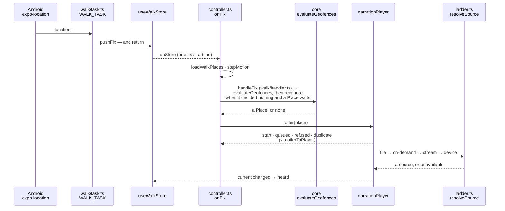
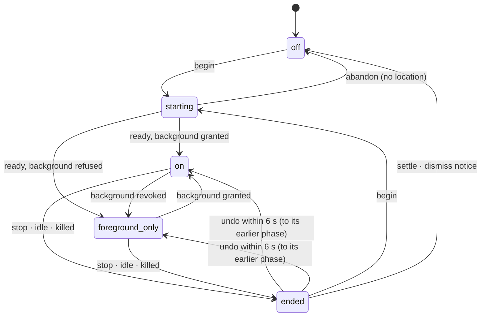
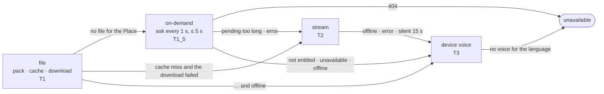

# Flow — a phone in a pocket tells a story

**How the Android app, with the screen off, decides that a tourist has arrived somewhere worth a story, and how the player then finds something to play.** Everything here runs on the phone; the server is reached only for audio it doesn't have yet. The rules that make it trustworthy — one story at a time, no paid placement, nothing twice per visit — live in `packages/core`, which has no clock, timers, network or storage of its own, so the same code is unit-tested, replayed from a walk log and run on the phone.

**Trigger:** the tourist taps *Start walk*. Every tunable below comes from `NARRATION_CONFIG` (`packages/contracts/src/narration/narration-config.ts`).

---

## 1. The path

**The task does nothing but store the fix.** `TaskManager.defineTask(WALK_TASK)` calls `pushFix()` and returns without awaiting anything (conventions §12.3); a store subscriber in `controller.ts` chains `onFix` on one serial promise, so fixes are handled in order and never two at once. The task is defined at module scope (imported from `app/_layout.tsx`), because Android may start the JavaScript bundle headless, with no screen, just to deliver a fix.

---

## 2. The walk's states

`walk/machine.ts` is a pure `step(walk, event, now, undoMs)`; an event that doesn't apply in the current phase changes nothing, so a double tap or a late callback is harmless.

- **Permissions** (`runStartFlow` in `walk/permissions.ts`): foreground location (with *Try again*), then background (an explainer, then Android's settings step), then notifications (Android 13+ only). No foreground location abandons the walk; no background gives a `foreground-only` walk, which listens only while the app is in front.
- **The foreground service** carries the walk's notification, with fixed text (known-gaps: no *Stop* action, no running time). It can be started only while the app is in front; a cadence change made from the background re-registers the updates without it, keeping the running service.
- **Motion** (`walk/motion.ts`): still for 2 minutes inside 50 m → the `stationary` cadence (30 s, balanced accuracy) when that mode is on; still for 30 minutes → the walk ends as `idle`, with a local notification. Moving: a fix every 5 s at high accuracy.
- **A killed walk** is recognised at the next launch (`stoppedBySystem`): no task running, or no fix for more than 120 s → `ended` as `system`, and the app says the phone stopped it.

---

## 3. The decision — the geofence engine

`loadWalkPlaces` reads the synced Places of the current language from SQLite (re-read every 5 minutes or when the language changes) and hands the engine **only** `id, kind, location, triggerRadiusM, narrationPriority, autoNarrationEnabled`. **`discoveryBoost` is not in the engine's `GeofencePlace` type** — paid placement can't reach the audio channel because the type has nowhere to put it ([ADR 0007](../../decisions/0007-paid-placement-never-reaches-the-audio-channel.md)).

| Step | Rule | Where |
| :---- | :---- | :---- |
| Entering | a good fix (accuracy ≤ 100 m) inside the radius starts or extends an entry; it is **confirmed** once it existed for `geofenceDebounceMs` — at least two fixes inside | `evaluateGeofences` (`packages/core/src/geofence/engine.ts`) |
| Leaving | one good fix outside deletes the entry; coming back needs a new debounce | the same |
| Once per visit | a Place already fired since its entry began never fires again, however long the tourist stays | `firedThisVisit` |
| Eligible | auto-narration on; not within `narrationCooldownMs` of its last decision; a Venue only if no Venue was chosen in the last `commercialNarrationWindowMs` | `isEligible` (`priority.ts`) |
| Order | Editorial before Venue, then `narrationPriority`, then nearer, then id | `byPriority` |
| Weak fix | not evaluated; `reconcile` re-checks confirmed entries against the last good fix | `handleFix` (`walk/handler.ts`) |
| A confirmed Place not yet told | one confirmed on the same fix as the winner, or while it was ineligible, is offered by `reconcile` on a later fix while the tourist stays inside: after a fix that decided nothing, whenever a confirmed Place is still waiting (`hasWaitingConfirmed`), at most once per `safetyReconcileIntervalMs` of fix time — never when nothing waits | `handleFix` |

**Eligibility filters before ordering**, so a capped Venue never blocks an Editorial Place. **The cooldown counts from the decision**, not from the audio's end, and a stopped story doesn't give it back.

**The offer** (`decideOffer` in `player/queue.ts`): nothing playing → `start`; the *Up next* slot free → `queued`; the Place already current or next → `duplicate`; both slots full → **`refused`**, and the handler restores the engine's `lastFiredAt` and Venue count for it and puts it on a retry list, offered again on every fix while the tourist is still inside.

---

## 4. The player — finding something to play

- **Every await is followed by a language check** (`stale()` in `resolveSource`): a result for a language the tourist has since left is `discarded`, never played (conventions §12.3).
- **A file is used only if its SHA-256 matches the record**, whether from an installed pack (`packAudioUri`) or the audio cache; a mismatching download is deleted and the ladder falls.
- **During play**, an error or 15 s without a first sound (`START_TIMEOUT_MS`, paused while the tourist pauses) falls one rung, with a quiet *switched* notice.
- **An auto offer with nothing to play is skipped silently**, and *Up next* starts; a tap that finds nothing shows *unavailable*.
- **Pauses** (`nextPause`): the tourist's, the headphones coming out, or the system's (a call). Only a system pause resumes by itself.
- **The lock-screen card** shows the Place, its area and its photo — for a file and the stream; the device voice has none (known-gaps).
- **"Offline" is the probe's last verdict** (`useNetworkStore.status`), which changes only when `checkNetwork()` runs — at launch, on return to the front after 15 minutes, on reconnect, at a language switch, the code sheet — and while a pack waits for a connection, `use-pack-boot.ts` probes on its own (once at boot, then every 30 s, `WAITING_PROBE_MS`). **Losing the connection mid-walk doesn't flip it**, and a walk started headless never probes (`unknown`): the ladder then tries on-demand and the stream (up to `START_TIMEOUT_MS`) before the phone's voice, and prefetch (online only) doesn't run.
- **What it records:** heard when the player **accepts** a narration — before the ladder finds a source, so a Place whose ladder ends `unavailable` is marked heard too (`markHeard`, table `heard_places`; Explore's badge and the map read it, and prefetch skips it); finished when it plays to its end (`markStoryFinished`, `stories_finished`; a tour's progress reads it); and, with consent, the analytics events (`narration-tracker.ts` — [analytics](./analytics.md)).

---

## 5. Offline, and the data the walk reads

- **The walk reads only the local database.** The background task never syncs; `runSync` runs at launch, on return to the front after 15 minutes, and when the network comes back — each only after the probe (`probeGateway`: two tries of 2.5 s) says the gateway answers.
- **Prefetch** runs from a fix, never a timer, online only: the 3 nearest unheard Places within 1.5 km — files downloaded to the cache, the rest asked for (`narrationPrefetch`), backing off on `429`.
- **Packs** put an area's audio on the phone; the ladder checks them first.
- **SQLite transactions run one at a time**, and a `BEGIN` that finds the database locked retries (`whenUnlocked`); a plain write waits up to 5 s (conventions §12.2).
- **A language switch** fetches the new language's words and syncs its Places *beside* the current ones, then changes `language` in one store update; the walk follows on its next fix. A story already sounding finishes in its language.

---

## 6. Edge cases

| Situation | What happens | Why |
| :---- | :---- | :---- |
| GPS jitter across a radius | a good fix outside resets the debounce | a story for a Place the tourist only grazed is the false trigger product §13 caps at 5 % |
| Several Places in range | one decision per fix; the others follow on later fixes while still inside | one story at a time |
| Sitting inside a radius for an hour | never fires twice | once per visit |
| A cluster of Venues | at most one Venue per window, the next once it reopens while the tourist is inside; Editorial Places unaffected | commercial pressure never crowds the audio channel |
| *Up next* full | the offer is refused, the decision undone, and retried each fix | nothing is lost while the tourist is still there |
| Background permission revoked mid-walk | noticed on the app's return to the front (not with the screen off): `foreground-only`, a notice, the updates restarted | the walk keeps what it can |
| App swiped away | the service keeps running; a headless task restores the walk | `killServiceOnDestroy: false` |
| Stop, then *Undo* within 6 s | the walk resumes in its earlier phase | an accidental stop costs nothing; Undo doesn't survive a relaunch |
| Language switched while a story prepares | the stale result is discarded and the story restarts in the new language | never the wrong language |
| A pack updating while the walk syncs | transactions queue and retry | "database is locked" once made every sync fail |

---

## 7. When it misbehaves — where to look first

| Symptom | Look at |
| :---- | :---- |
| Nothing played while walking | the walk log, `walk-log.jsonl`, written in every build — shared from Diagnostics builds (*Share walk log*), where `adb logcat -s ReactNativeJS` also shows its `WALKLOG` lines: `engineCall` lines — `decision` null? `accepted` false? only `reconcile` lines (weak fixes)? Replay with `node packages/core/scripts/replay-walk.mjs <log> <places.json>` |
| No `engineCall` lines at all | the task (`walk/task.ts` imported by `app/_layout.tsx`); an `error` line from `startUpdates`; a `foreground-only` walk with the screen off |
| A decision, but no sound | **the `narration` line is written when the player accepts, before any source is found**, and an auto offer with nothing to play is cleared without a notice — the log has no line for the ladder's outcome; check its inputs: the network verdict, the device voice for the language, the pack index |
| A long silence before the phone's own voice, or no prefetch after the app was swiped away | the network verdict (§4): the connection dropped mid-walk or the walk started headless, so the ladder tried on-demand and the stream first |
| One Place never fires | a confirmed Place waits for the next `reconcile` — at most one per `safetyReconcileIntervalMs` of fixes — so look for its `reconcile` line; is it in `place_records` for this language, and has the walk re-read them (`walkPlaces` is cached 5 minutes)? auto-narration, cooldown, the Venue window, its radius; `offerToPlayer` returns `skipped` for a record it can't find |
| The walk ended by itself | `walk` lines with `endReason`: `idle` (still 30 minutes), `system` (the phone stopped it) |
| A language switch hangs | the switch's state — `useSwitchStore` (`language/switch.ts`) and `useAppStore`'s `pendingLanguage` and `switchStartedAt`; Diagnostics' three holds (`i18n/switch-holds.ts`) can stall it on purpose |

The Diagnostics screen (`app/settings/diagnostics.tsx`) exists in builds with `EXPO_PUBLIC_DIAGNOSTICS=1`: *Simulate walk* (a recorded trace through `pushFix`), *Weak GPS*, *No position*, *Stand still 31 min*, the queue test and the switch holds.

---

## 8. Related

- [`analytics.md`](./analytics.md) — what the player records, with consent
- [product-overview](../../product-overview.md) §F2–§F4; [development-conventions](../../development-conventions.md) §12.2–§12.3
- ADRs [0007](../../decisions/0007-paid-placement-never-reaches-the-audio-channel.md), [0026](../../decisions/0026-our-own-geofence-engine.md)
- [`../known-gaps.md`](../known-gaps.md) — the walk's notification, the device voice's missing card, the wake-up net
