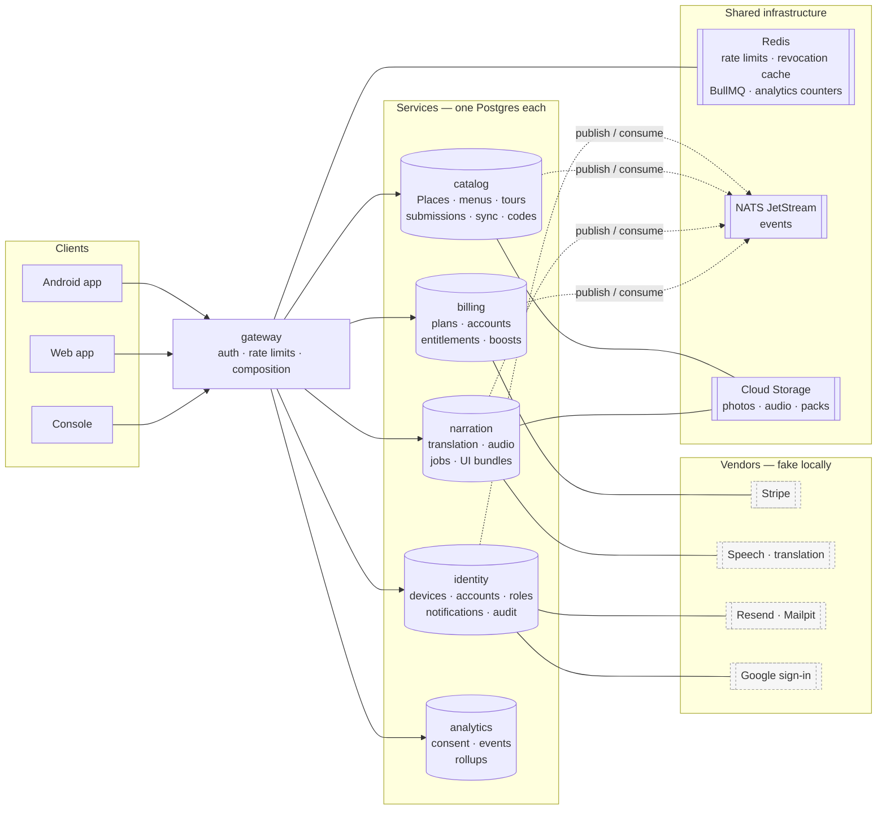
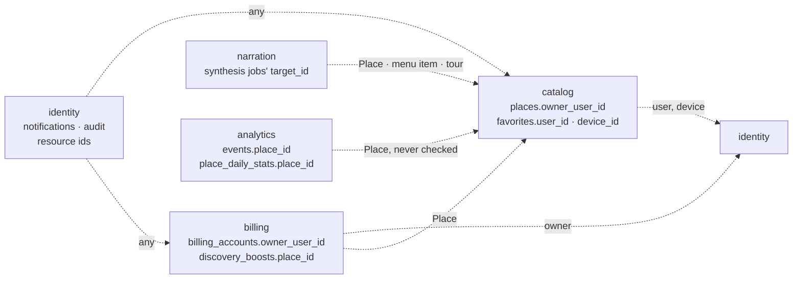
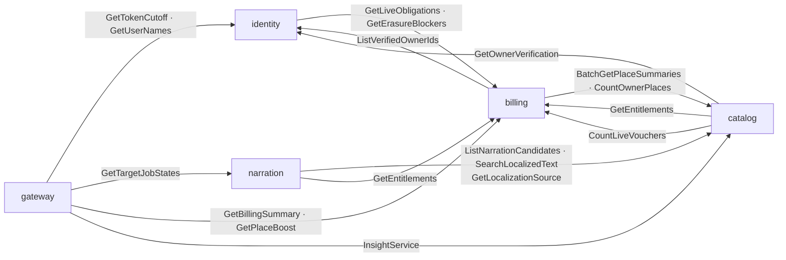
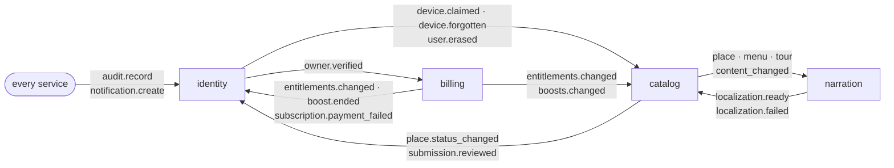

# Cross-service flows

**The view no single service can give you.** What lives inside one schema is in that service's Prisma schema (and, once generated, in `erd/`); what one endpoint accepts and returns is in Swagger; what happens along one path is in [`flows/`](./flows/README.md). What is left is here: who owns what, who calls whom synchronously, who tells whom asynchronously, and the rules every crossing obeys.

**Read this before a flow** when the question is *"which service owns this?"* or *"who else hears about it?"*. A flow is a vertical through one path; this page is the horizontal across all of them.

---

## 1. The services and their stores

Five backend services and the gateway. Each service owns **one Postgres database** and nothing else reads it ([rdm-spec](../rdm-spec.md) §1.1). The gateway owns no database: it is the only public HTTP surface, verifies every token, applies the rate limits and composes answers from the services over gRPC.

- **Analytics publishes and consumes nothing.** It is reached only by the gateway, and its one shared store is Redis, for the heatmap's and the runtime lane's counters ([flows/analytics](./flows/analytics.md)).
- **The phone and the web app download media straight from Cloud Storage** (photos, audio, map packs) by the URLs the services hand out; the gateway never streams a stored file. The live speech stream is the exception: it is generated per request and passes through narration.
- **`ai`** (description enhancement) is specified but deferred; nothing calls it.

---

## 2. Who references whom — the ownership map

**No foreign key crosses a service** ([ADR 0013](../decisions/0013-no-cross-service-foreign-keys.md)). A column holding another service's id is validated **at write time over gRPC**, or trusted because it arrived in that service's own event; nothing in a database enforces it, and nothing cascades.

- **A deleted Place is soft-deleted** in catalog (a tombstone for sync), so every id pointing at it still resolves to "deleted" rather than to nothing.
- **Analytics never validates a Place id** — events are anonymous counts; a read joins names from catalog and drops the ids catalog no longer returns.
- **An erased user** is announced (`identity.user.erased`), and each holder clears what it keeps: catalog its favourites and the owner's Places, billing its account.

---

## 3. Synchronous calls — gRPC

The gateway's calls mirror the routes one-to-one ([api-endpoints-plan](../api-endpoints-plan.md) §12.1). **Service-to-service calls are few, and each is a coupling someone justified** (§12.2):

**Every call has a 2-second deadline** unless §12.2 says otherwise, and **every caller decides in advance what a failure means** — and the answer differs on purpose:

| When the call fails | Rule | Examples |
| :---- | :---- | :---- |
| A limit check | **deny** — never assume a grant | `GetEntitlements` → `503 ENTITLEMENTS_UNAVAILABLE` |
| A guard before a destructive or money write | **refuse the write** | `GetOwnerVerification` (catalog), `GetLiveObligations`, `CountLiveVouchers` → `503` |
| A security check | **refuse** — a stale "no restriction" is the window a takeover uses | `GetTokenCutoff` → `503` on account routes |
| A read that decorates a screen | **degrade** — the screen loads, the decoration says it couldn't | `GetBillingSummary` → `meta.degraded: ["billing"]`; `GetUserNames` → names `null` |
| Background work | **retry later** | `GetLocalizationSource` — the job retries with backoff |

**Batch RPCs map results by the requested keys**, never by response order.

---

## 4. Asynchronous events — JetStream

Every service that publishes writes the event into its **`outbox_events`** table **in the same transaction** as the change it announces; a relay publishes the rows in order with `Nats-Msg-Id` set to the row's id, so a relay that crashes after publishing produces a deduplicated duplicate, never a second event. Every consumer records what it handled in **`processed_events`** and skips a repeat ([rdm-spec](../rdm-spec.md) §1.11, §2.10, §2.11). The trace context travels on the outbox row, since an event leaves on a later poll, outside the request (architecture §11).

- **Identity is the sink for people-facing side effects**: every audit row and every notification is written by identity, from any service's event — so a notification is never lost to the service that caused it being down.
- **Catalog is the sink for content state**: narration never writes a Place; it announces a localization, and catalog decides what that means for the Place (its audio, its `sync_version`, the activation gate).
- **The voucher, offer, order, staff and payout events** are named in contracts and published by nothing while the voucher chain waits ([ADR 0066](../decisions/0066-the-voucher-chain-waits-for-a-way-to-pay-vietnamese-venues.md)). `PHASE_3_OWED` in `packages/config/guards/event-topology.spec.ts` is the list; the guard fails when one is published without leaving it.

The full table — every subject, its payload and every consumer's action — is [api-endpoints-plan](../api-endpoints-plan.md) §10.

---

## 5. Rules every crossing obeys

| Rule | Where it is enforced |
| :---- | :---- |
| No foreign key across services; ids validated by gRPC at write time | each service's write path; [ADR 0013](../decisions/0013-no-cross-service-foreign-keys.md) |
| An event is written in the same transaction as its change | the outbox; a publish outside it is a bug |
| A consumer is idempotent | `processed_events`, per consumer |
| A row another transaction may also lock is locked as `FOR NO KEY UPDATE` on its parent first; a deadlock or serialization failure is retried, never counted as an attempt | conventions §8.8 |
| Readiness never depends on a peer | `/health/ready` checks only the service's own database, Redis, NATS and storage (api §13) |
| Scheduled work is a BullMQ repeat recorded in `job_runs`, so many replicas run one schedule | each service's `SCHEDULED_JOBS`; `/admin/jobs` shows stale and failing ones |

---

## 6. When it misbehaves — where to look first

| Symptom | Look at |
| :---- | :---- |
| A change in one service never showed up in another | that service's `outbox_events` (is the row unpublished?), then the consumer's `processed_events` and its logs |
| The same side effect happened twice | the consumer's idempotency key — a handler that writes before recording `processed_events` |
| A screen shows "couldn't load" for one part only | `meta.degraded` in the response: a decorating gRPC call failed (§3) |
| Owners can't save, with `503` | `GetEntitlements` or `GetOwnerVerification` failing — billing or identity down (§3's deny rows) |
| A slow request | its trace in Jaeger: gateway span → gRPC spans → queries; an event's consumer span links back through the outbox's trace context |
| A scheduled job stopped | `/admin/jobs` (`stale`, `failing`, `never-ran`), then that service's `job_runs` |

---

## 7. Related

- [`flows/`](./flows/README.md) — one document per end-to-end path
- [api-endpoints-plan](../api-endpoints-plan.md) §10 (events), §12 (route ownership, internal RPCs)
- [rdm-spec](../rdm-spec.md) §1.1, §1.11, §2.10–§2.12
- [architecture-and-tech-stack](../architecture-and-tech-stack.md) §2, §11
